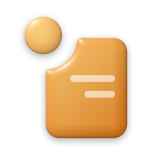

<p align="center">
  
</p>

<h1 align="center">اسحب · Eshab</h1>

<p align="center"><b>حوّل ملفاتك وعدّلها بسحبة واحدة.</b><br>
اسحب أي ملف، اضغط Shift، واختر الصيغة من العجلة. النتيجة تنحفظ بجانب الملف الأصلي.</p>

<p align="center"><a href="https://github.com/aketo1/eshab/releases/latest"><b>تنزيل «اسحب» لويندوز</b></a></p>

<div dir="rtl">

## كيف يشتغل

اسحب ملفًا من سطح المكتب أو من المستكشف، وأثناء السحب اضغط أحد المفاتيح؛ تظهر عجلة من البطاقات حول المؤشر:

| المفتاح | العجلة | وش فيها |
|---|---|---|
| **Shift** | تحويل | الصيغ المناسبة للملف: PDF، Word، صور، صوت، فيديو… |
| **Alt** | الأدوات | ضغط، قص، تعديل الصور، كتابة ورسم، تعديل PDF، قراءة QR… |
| **Ctrl** | إجراءات | نسخ، نقل، نسخ المسار، فتح الطرفية، والرف المؤقت |

أفلت الملف على البطاقة وخلاص؛ الملف الأصلي ما يتغيّر أبدًا. وتقدر تغيّر المفاتيح من الإعدادات.

## المميزات

- **عجلة زجاجية** تظهر عند المؤشر وتعرض بس اللي يناسب ملفك.
- **قائمة الزر الأيمن:** «اسحب» ← تحويل / الأدوات / إجراءات، لأكثر من ملف مرة وحدة.
- **الجزيرة:** شريط صغير أعلى الشاشة يعرض التقدّم، ما ياخذ ضغطاتك، ومرّر الماوس عليه لفتحه.
- **الرف المؤقت** داخل الجزيرة: حط فيه ملفات واسحبها بعدين لأي مكان.
- **آخر الملفات:** كل ملف يطلعه «اسحب» تلقاه في الجزيرة أو من قائمة الأيقونة.
- **خيارات العجلات:** قدّم البطاقات اللي تستخدمها كثير، واخفِ اللي ما تحتاجها.
- **محررات خفيفة** للصور والصوت والفيديو وPDF، مع خط **قبل وبعد** للمقارنة.
- **ثلاثة ألوان:** عسل، زجاج صافي، حبر.
- يشتغل **محليًا على جهازك**؛ ما يرفع ملفاتك لأي مكان.

## التثبيت

نزّل **Eshab-Setup-2.0.0.exe** من [الإصدارات](https://github.com/aketo1/eshab/releases/latest) وشغّله:
اختر اللون والخيارات ومكان التثبيت، واضغط «تثبيت». ما يحتاج صلاحيات مسؤول.
إلغاء التثبيت من «الإعدادات ← التطبيقات المثبتة» في ويندوز، وإعداداتك تبقى محفوظة.

يحتاج ويندوز 10 أو 11 (64 بت).

## للمطوّرين

```powershell
python -m venv .venv
.venv\Scripts\pip install -r requirements.txt
.venv\Scripts\python main.py
```

البناء: `python -m PyInstaller --noconfirm --clean packaging\eshab.spec`
ثم ملف التثبيت: `python packaging\make_setup.py dist\Eshab "dist\تثبيت اسحب.exe"`
(FFmpeg يوضع في `tools\` قبل البناء).

</div>

## English

**Eshab** turns a file into another format, or opens a light editor for it, from a single drag: drag any file, hold **Shift** (convert), **Alt** (tools) or **Ctrl** (actions), and drop it on a card of the wheel that appears at the pointer. The result is saved next to the original, which is never changed. It also lives in Explorer's right-click menu, shows progress in a small island at the top of the screen, and keeps your recent results. Everything runs locally. Windows 10/11, 64-bit.

## License

MIT — see [LICENSE](LICENSE).
